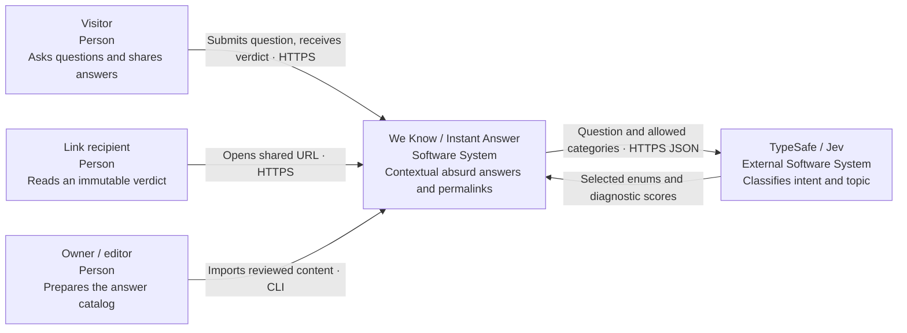
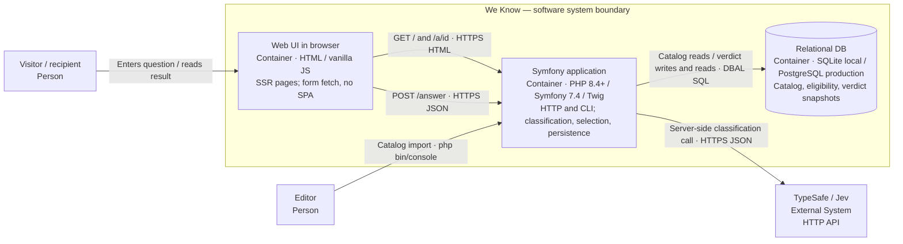
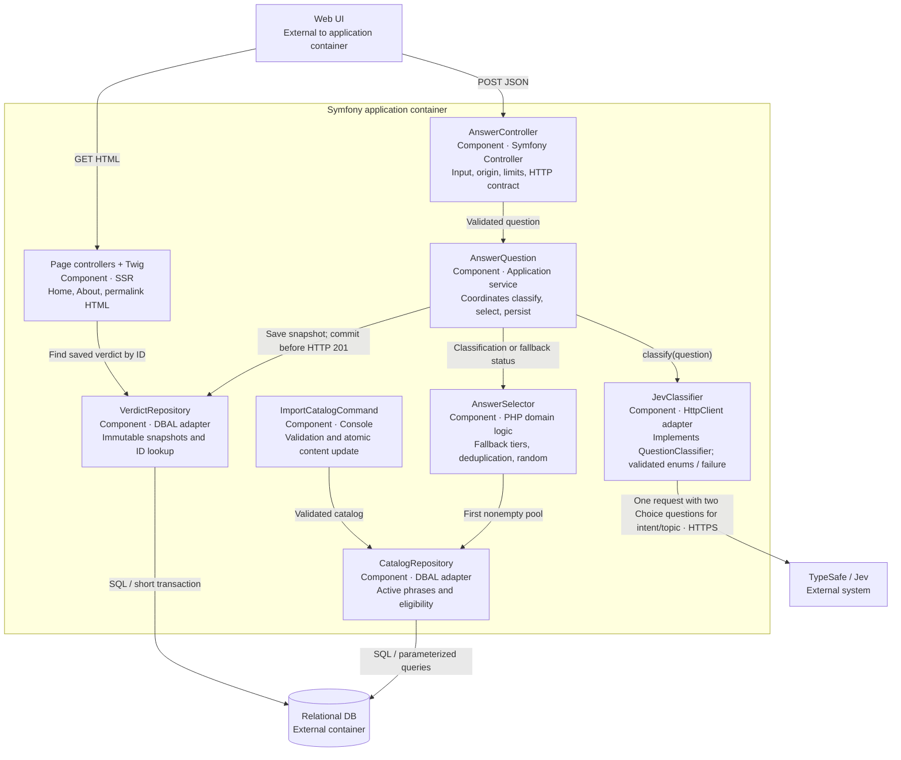
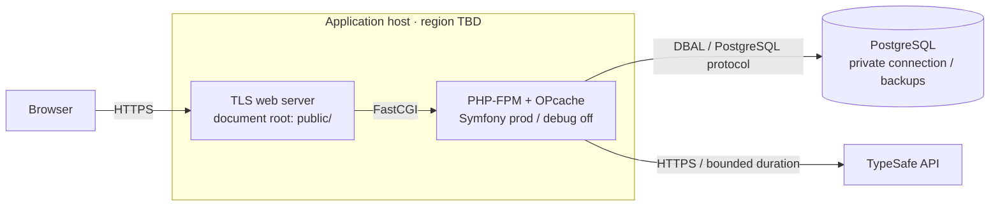

# C4: target MVP architecture

Status: **target MVP model**, updated 2026-10-15. Implemented locally: Symfony/Twig, active v2 classification (Jev adapter/DI, taxonomy, 100-question corpus, tests, evaluation CLI), catalog/import, selector, answer creation/persistence, POST and permalink SSR. The dark-theme form/fetch, sharing, About/FAQ, data disclosure and styled errors are also implemented and offline tested. Production topology remains a target; actual checks are in [verification](../verification.md).

The diagrams use C4 semantics in ordinary Mermaid: each block names its element type and arrows are labeled. We Know is the system boundary; TypeSafe is external. A C4 container means an executable application or store, not necessarily Docker. The [official C4 model](https://c4model.com/diagrams) does not require all four levels; add L4 when implemented domain code has complex relationships worth explaining.

## L1 — System Context

TypeSafe does not generate the final phrase. Reading a saved verdict does not depend on TypeSafe. The owner will manage the catalog through explicit atomic CLI import; the MVP has no web admin.

## L2 — Containers

The same Symfony application delivers the UI; there is no separate frontend deployment. The database is one logical role, not simultaneous SQLite/PostgreSQL replication. Locally it is a file; production uses PostgreSQL. Public assets are served by a web server, a deployment detail rather than a separate business system. Development is PHP 8.4 with planned 8.5; Composer now requires/resolves PHP 8.4; actual runtime checks use 8.4.10.

## L3 — Components in the Symfony application

Selectors do not know Jev transport/JSON. The adapter does not know the joke library. HTTP controllers do not implement classification/random selection. All components belong to one process/code project, not network microservices.

The catalog stores `humor_mechanism` on eligibility, prepared during content authoring and ignored by the selector. The user accepted VerdictRepository persistence of text snapshots, nullable eligibility FK with ON DELETE SET NULL, and short `decision_context`: actual provider, requested/resolved model, labels or failure, actual selected pool/tier/count/algorithm/mechanism and fallback reason. SQLite persistence is tested; PostgreSQL server acceptance is outstanding; the [data model](data.md) records the accepted requirements.

## Dynamic — creation and repeated reading

Rejected input/origin/rate-limit checks terminate before App/Jev. An empty universal pool or persistence failure returns 503 with no permalink: alternative failure paths to the successful save shown here. A permalink remains readable during Jev outages if the database is available.

## Deployment — minimal outline

Hosting, PostgreSQL version, network boundaries, and backups need definition before deployment. Worker mode/FrankenPHP is not an initial requirement; decide from measurements. Nothing has been deployed by this work.
