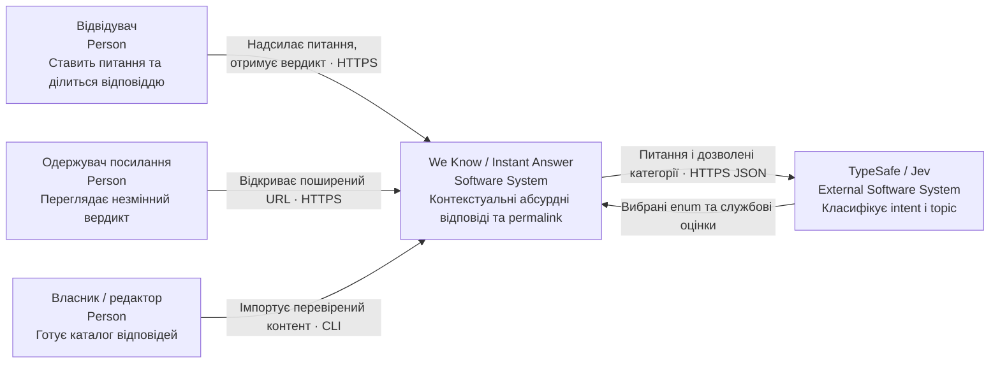
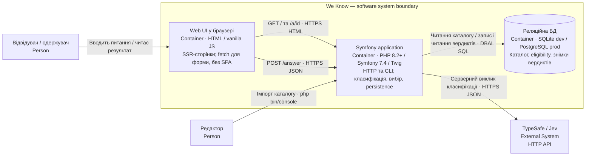
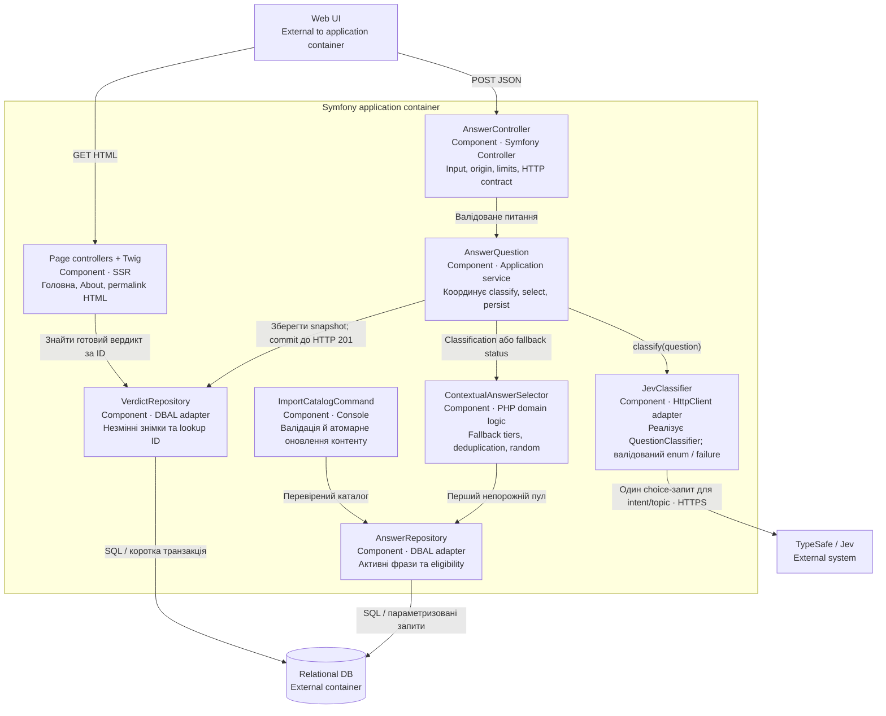
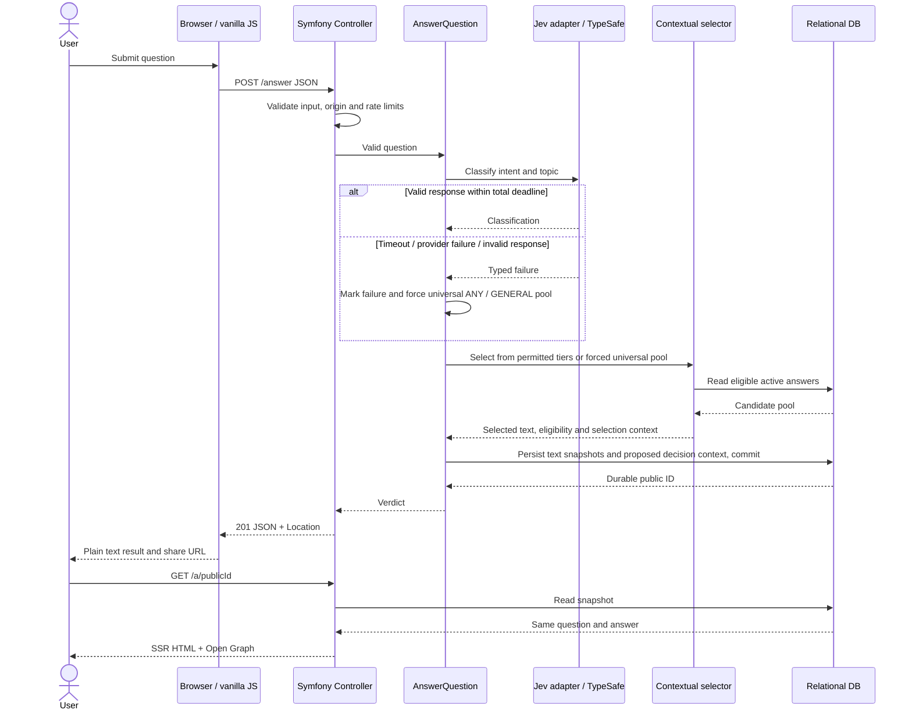
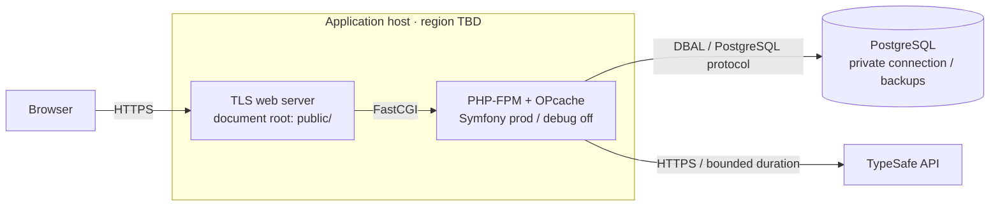

# C4: цільова архітектура MVP

Статус: **цільова MVP-модель**, 2026-10-11. Реалізовано Symfony kernel/Twig/GET skeleton і classification частину етапу 1: Jev adapter/DI, taxonomy/corpus, тести й evaluation CLI. Selector, application answer flow та persistence ще не реалізовані. Діаграми нижче описують цільову архітектуру; фактичний результат етапу 1 наведено у verification.

Діаграми використовують семантику C4 зі звичайною Mermaid-нотацією: тип елемента вказаний у кожному блоці, стрілки підписані. Межа системи — We Know, зовнішній сервіс — TypeSafe. C4 container тут означає виконуваний застосунок або сховище, а не обов'язково Docker. [Офіційна модель C4](https://c4model.com/diagrams) не вимагає всіх чотирьох рівнів; L4 варто додати після появи доменного коду, коли він пояснюватиме реальні складні взаємозв'язки.

## L1 — System Context

TypeSafe не генерує фінальну фразу. Читання збереженого вердикту не залежить від TypeSafe. Каталогом керує власник через майбутній CLI import; web admin у MVP немає.

## L2 — Containers

Web UI доставляється тим самим Symfony-застосунком; окремого frontend deploy немає. База на діаграмі — одна логічна роль, а не одночасна реплікація SQLite і PostgreSQL. У dev це локальний файл, у production пропонується PostgreSQL connection. Public assets обслуговує web server; web server — deployment detail, не окрема бізнес-система.

## L3 — Components у Symfony application

Selectors не знають transport/JSON Jev. Адаптер не знає бібліотеки жартів. HTTP-контролер не реалізує класифікацію чи random. Усі компоненти — частини одного процесу/кодового проєкту, не мережеві мікросервіси.

Каталог міститиме `humor_mechanism` у eligibility, заповнений під час підготовки контенту; selector його ігнорує. Для VerdictRepository запропоновано текстові snapshots, nullable eligibility FK і короткий `decision_context`: категорії класифікатора, фактично вибраний пул/механізм та причини fallback. Це ще не затверджений контракт збереження; [модель даних](data.md) розділяє прийняті вимоги й пропозицію.

## Dynamic — створення й повторне читання

Відхилені input/origin/rate limit завершують запит до App/Jev. Порожній universal pool або persistence failure завершуються 503 і не видають permalink; це альтернативні failure paths до показаного успішного збереження. Відкриття permalink працює під час відмови Jev, якщо доступна БД.

## Deployment — мінімальний орієнтир

Хостинг, версія PostgreSQL, мережеві межі й резервні копії потребують конкретизації перед deployment. Worker mode/FrankenPHP не є стартовою умовою; рішення приймати за вимірами. Публікацію зараз не виконано.
