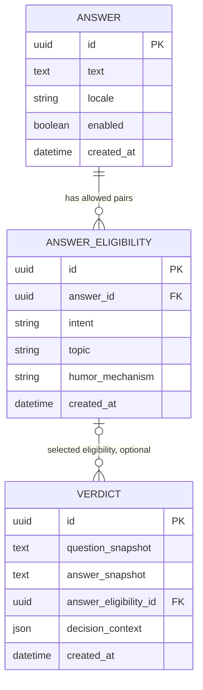

# Data: proposal before implementation

No database exists and Doctrine is not installed. **SQLite locally and PostgreSQL in production are definite user choices**, clarified during the documentation audit. Database versions and hosting remain open.

UUID PK and `created_at` in every table, `humor_mechanism` on eligibility, and removal of revision fields are accepted requirements. The simplified `VERDICT` and `decision_context` below are **proposals for agreement**, not an approved or implemented schema.

## Model



Names are conceptual, not a generated schema. **Every table has its own UUID primary key and UTC `created_at`.** `ANSWER_ELIGIBILITY` also has unique `(answer_id, intent, topic)` and index `(intent, topic, answer_id)`; these are not a composite PK. Enabled/locale checks join ANSWER. This is sufficient for a small catalog; add other indexes based on query plans. `ANSWER.revision` and `VERDICT.answer_revision` were removed by user decision.

## Why pairs are stored

Independent intent and topic sets would create an unwanted Cartesian product. An answer allowed for `(WHY, WORK)` and `(WHEN, TECH)` must not automatically be eligible for `(WHY, TECH)`. Each eligibility row is explicit editorial approval. Classification categories are controlled string-backed enums with taxonomy versions; a separate CRUD dictionary is unnecessary before administration.

`ANY` means universal answer form; `OTHER` means a successfully classified question of unknown form. They differ. `GENERAL` is the general topic. Do not use comma-separated categories or JSON as the primary selection index.

`humor_mechanism` is populated during catalog preparation/generation. It describes phrase eligibility for a particular pair, not a question category returned by Jev. The **future** selector ignores it: no pool filtering or weighting. It is retained for possible statistics; likes, votes, or owner evaluation remain possibilities, with no corresponding tables/routes/implementation.

Proposal: one controlled string-backed mechanism per eligibility. Initial candidates: `metaphor`, `hyperbole`, `oxymoron`, `paradox`, `false_causality`, `false_authority`, `reversal`, `bureaucratic_absurdity`; final codes need editorial agreement. Do not add the mechanism to uniqueness: multiple rows for the same `(answer_id, intent, topic)` risk biasing random selection. Multiple mechanisms for one eligibility are a separate future decision. Do not add runtime templates or weights now.

## Immutable verdict

`VERDICT.id` is an unpredictable UUIDv4 primary key. The public URL contains no question. Store final text rather than just a FK: editing/disabling ANSWER must not change an issued permalink. Proposed nullable `answer_eligibility_id` points to the actual selected row, through which the original ANSWER is available. Proposed FK policy: `ON DELETE SET NULL`; deleting eligibility must not delete the verdict or snapshots. Fallback alone does not make the FK null: selection from `(ANY, GENERAL)` points to that row.

### Proposal: short `decision_context`

The user questioned separate VERDICT columns for `intent`, `topic`, `classification_status`, `fallback_reason`, `model_version`, `taxonomy_version`, `rubric_version`, `selection_version`, and `locale`. They are no longer an accepted column set. The requirement is to explain why an answer was chosen and what participated in selection. One small event JSON snapshot plus an eligibility FK is proposed.

The FK shows the current catalog, not the historical reason: categories/mechanisms can be edited and rows deleted. JSON deliberately records selection-time facts. Classifier categories and the actual selected pool may differ due to fallback. Synthetic example of successful classification with an empty exact pool:

```json
{
  "classifier": {
    "provider": "typesafe",
    "model": "jev-1.13.0",
    "intent": "WHEN",
    "topic": "TECH"
  },
  "selection": {
    "tier": "intent_general",
    "reason": "exact_pool_empty",
    "pool": {"intent": "WHEN", "topic": "GENERAL"},
    "candidate_count": 8,
    "algorithm": "uniform_random",
    "humor_mechanism": "false_authority"
  }
}
```

Proposed minimum:

- `classifier`: provider/model only when actually called; retain validated intent/topic if received. Prefer the resolved response model; if there is no response, a separate `requested_model` may record only what was requested. On failure record normalized `failure_reason` (e.g. `timeout`), without fabricated successful labels. If a call is skipped, record the skip reason rather than inventing a provider/model call.
- `selection`: actual tier (`exact`, `intent_general`, `universal`), pool intent/topic snapshot, unique candidate count before random selection, `algorithm: uniform_random`. Include `reason` only to explain fallback, e.g. `exact_pool_empty`, `intent_pools_empty`, `classification_failed`.
- Selection `humor_mechanism`: a snapshot of the selected eligibility's mechanism for future statistics. It did not participate in selection. Renaming the catalog mechanism does not rewrite the event.

Under the future policy, a Jev failure sends the selector directly to `(ANY, GENERAL)`; an internal application fallback context `OTHER/GENERAL`, if used, is not recorded as Jev's response. Successful `OTHER/GENERAL` is a genuine result and follows normal tiers. The implemented adapter does not implement either selection policy.

This is a diagnostic explanation, not exact random replay. Do not store the full candidate list, raw provider response, secrets, IP, or invented revision fields. Add confidence only if it affects a decision; full rubric/taxonomy/request versions are not mandatory MVP verdict fields and may remain in evaluation reports. A separate VERDICT locale is unnecessary for an English snapshot. JSON does not replace normalized eligibility queries and is not public API output by default. Agree final structure/key names before implementation.

A transaction starts after external classification: eligible-pool reading, eligibility selection, and text/diagnostic snapshot insertion must be consistent within one flow. Catalog import is atomic. HTTP 201 follows commit. Write failure → 503 without a broken URL.

Immutability does not mean indefinite retention. Retention, requested deletion, and indexing policy need decisions before public release. Deleted IDs must not be reused.

## SQLite and PostgreSQL

Doctrine DBAL + Migrations is proposed. [DBAL supports SQLite/PostgreSQL platforms](https://www.doctrine-project.org/projects/doctrine-dbal/en/current/reference/platforms.html), but does not make types, locking, or DDL identical.

- Store UUIDs as portable strings and time as UTC with consistent precision; avoid native enum/JSONB/array dependence in base queries.
- Enable SQLite foreign keys for each connection. Prove enforcement with a test, not configuration alone.
- Keep SQLite under `var/`, outside `public/`, without a network filesystem. Consider busy timeout/WAL for development after checking test modes. SQLite is not evidence of production concurrency.
- Run migrations on empty SQLite and real PostgreSQL; branch SQL by platform where necessary. Do not automatically transfer SQLite-generated SQL to PostgreSQL.
- For production verify query plans, Unicode/length constraints, uniqueness/FKs, transaction errors, and concurrent inserts.
- The local development database need not migrate to production as a file. Transfer the catalog through controlled idempotent import with stable IDs; verdict transfer, if needed, requires a separate verified procedure.

### Migration lifecycle

Accepted by user: **before production**, while data is local/test and disposable, development migrations may be edited in place and databases rebuilt. Every refinement to an unreleased schema need not create another migration. This governs future development: there are currently no migrations, and this task creates/resets no database.

Once shared/persistent data needs preservation, including production, applied migrations become immutable: every change is a new incremental migration with upgrade/data-preservation checks. This documentation does not authorize deployment.

## Editorial import

Initial proposal: a versioned content file and console import command, no web admin. Define the format alongside the catalog, not in advance. Validate UUIDs and stable answer/eligibility IDs, `created_at` (reimport does not rewrite creation time), nonempty text, locale `en`, allowed intent/topic and `humor_mechanism`, no duplicate triples, and at least one active `(ANY, GENERAL)` answer. One invalid entry must not leave a partially updated catalog.

The MVP should cover each supported intent with several different GENERAL answers. Quantity, editorial quality, and repetition are content-stage criteria, not a claim that a library exists.
