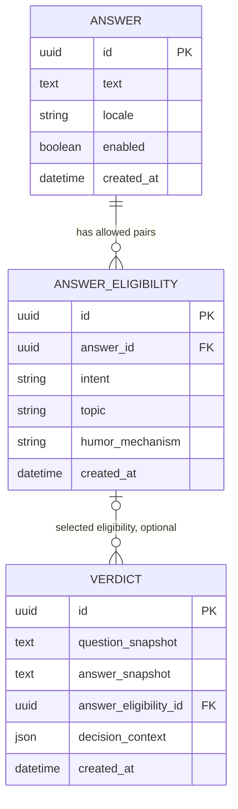

# Дані: пропозиція перед реалізацією

Поки БД не створена й Doctrine не встановлено. Користувач припускає SQLite локально й PostgreSQL (або іншу реляційну БД) у production. Плановий production target — PostgreSQL; остаточний вибір перед етапом міграцій.

UUID PK та `created_at` у кожній таблиці, `humor_mechanism` у eligibility і відсутність полів revision — прийняті уточнення користувача. Спрощений склад `VERDICT` та `decision_context` нижче — **пропозиція для погодження**, не затверджена чи реалізована схема.

## Модель



Імена полів/таблиць концептуальні, не згенерована schema. **Кожна таблиця має власний UUID primary key і `created_at` у UTC.** `ANSWER_ELIGIBILITY` додатково має unique constraint `(answer_id, intent, topic)` та індекс `(intent, topic, answer_id)`; це не складений PK. Перевірку enabled/locale виконує join до ANSWER. Для малого каталогу цього досить; інші індекси — за query plans. `ANSWER.revision` та `VERDICT.answer_revision` вилучено з моделі за рішенням користувача.

## Чому зберігаємо пари

Окремі множини intent і topic створили б небажаний декартів добуток. Відповідь, дозволена для `(WHY, WORK)` та `(WHEN, TECH)`, не повинна автоматично ставати кандидатом для `(WHY, TECH)`. Кожен рядок eligibility — явна редакторська придатність. Категорії поки контрольовані string-backed enum з версією таксономії; окремий CRUD-довідник не потрібен до адмінки.

`ANY` означає універсальну форму відповіді; `OTHER` — класифіковане питання невідомої форми. Це різні поняття. `GENERAL` — загальна тема. Категорії не зберігати comma-separated полем; JSON не використовувати як основний індекс підбору.

`humor_mechanism` заповнюється під час підготовки чи генерації каталогу відповідей. Це властивість придатності фрази для конкретної пари, не категорія питання, яку має повертати Jev. Поточний selector поле ігнорує: воно не фільтрує пул і не змінює ваги. Поле зберігається для майбутньої статистики; лайки, голосування чи оцінка власником залишаються можливостями, без таблиць, маршрутів або реалізації зараз.

Пропозиція: один механізм на рядок eligibility, контрольований string-backed перелік. Початкові кандидати: `metaphor`, `hyperbole`, `oxymoron`, `paradox`, `false_causality`, `false_authority`, `reversal`, `bureaucratic_absurdity`; перелік потребує редакторського рішення. Не додавати механізм до unique constraint: кілька рядків для тієї самої трійки `(answer_id, intent, topic)` створили б ризик зміщення random. Кілька механізмів для однієї придатності — окреме майбутнє рішення. Шаблони й ваги не додавати зараз.

## Незмінний вердикт

`VERDICT.id` — непередбачуваний UUIDv4 primary key. Публічний URL не містить питання. Зберігати остаточний текст, а не тільки FK: редагування чи вимкнення ANSWER не змінює вже виданий permalink. Запропонований nullable `answer_eligibility_id` посилається на конкретний вибраний рядок, через який доступна вихідна ANSWER. Пропонована політика FK — `ON DELETE SET NULL`: видалення eligibility не видаляє вердикт чи його знімки. Сам fallback не робить FK порожнім: якщо вибрано `(ANY, GENERAL)`, посилання веде саме на цей рядок.

### Пропозиція: короткий `decision_context`

Користувач поставив під сумнів окремі `intent`, `topic`, `classification_status`, `fallback_reason`, `model_version`, `taxonomy_version`, `rubric_version`, `selection_version`, `locale` у VERDICT. Вони більше не подаються як прийнятий набір колонок. Потреба — пояснити, чому обрано відповідь і що брало участь у виборі. Пропонується один невеликий JSON-знімок події разом із FK на eligibility.

FK показує поточний каталог, але не історичну причину: категорії чи механізм можуть бути відредаговані, а рядок — видалений. JSON навмисно фіксує факти на момент вибору. Категорії класифікатора і фактично вибраний пул можуть різнитися через fallback. Синтетичний приклад успішної класифікації з порожнім точним пулом:

```json
{
  "classifier": {
    "provider": "typesafe",
    "model": "jev-1.13.0",
    "intent": "WHEN",
    "topic": "TECH"
  },
  "selection": {
    "tier": "intent_general",
    "reason": "exact_pool_empty",
    "pool": {"intent": "WHEN", "topic": "GENERAL"},
    "candidate_count": 8,
    "algorithm": "uniform_random",
    "humor_mechanism": "false_authority"
  }
}
```

Пропонований мінімум:

- `classifier`: provider і модель лише за фактичного виклику; зберігати валідовані intent/topic, якщо отримані. Фактичний model із відповіді має перевагу; якщо відповіді немає, окремий `requested_model` може зафіксувати лише запитану модель. При failure — нормалізований `failure_reason` (наприклад `timeout`), без вигаданих успішних labels. Якщо виклик пропущено, зафіксувати причину пропуску, а не вигадувати provider/model call.
- `selection`: фактично використаний tier (`exact`, `intent_general`, `universal`), snapshot intent/topic пулу, кількість унікальних кандидатів до random, `algorithm: uniform_random`. `reason` — лише коли треба пояснити fallback; наприклад `exact_pool_empty`, `intent_pools_empty` або `classification_failed`.
- `humor_mechanism` у selection — знімок механізму вибраної eligibility для майбутньої статистики. Він не брав участі у виборі. Перейменування механізму в каталозі не переписує стару подію.

При помилці Jev selector одразу бере `(ANY, GENERAL)`; технічний fallback-контекст `OTHER/GENERAL`, якщо використаний усередині application, не записується як відповідь Jev. Успішна класифікація `OTHER/GENERAL` натомість є справжнім результатом і проходить звичайні tiers.

Це діагностичне пояснення, а не гарантія точного відтворення random. Не зберігати повний список кандидатів, raw provider response, секрети, IP або вигадані revision-поля. Confidence додавати лише якщо від нього залежить рішення; повні rubric/taxonomy/request versions не є обов'язковими полями MVP-вердикту. Їх можна вести у дослідницьких evaluation reports. Окрема locale у VERDICT зараз не потрібна для англомовного snapshot. JSON не замінює нормалізовані eligibility-запити і не віддається публічним API за замовчуванням. Остаточну структуру та назви ключів погодити перед реалізацією.

Транзакція починається після зовнішньої класифікації: читання придатного пулу, вибір eligibility й insert текстових та діагностичного snapshot узгоджуються в одному сценарії. Catalog import атомарний. Відповідь HTTP 201 — після commit. Failure на записі → 503, без непрацюючого URL.

Незмінність не дорівнює безстроковому зберіганню. Retention, видалення на запит і політика індексації потребують рішення перед public release. Видалений результат не має перевикористовувати ID.

## SQLite і PostgreSQL

Пропонується Doctrine DBAL + Migrations. [DBAL має платформи SQLite/PostgreSQL](https://www.doctrine-project.org/projects/doctrine-dbal/en/current/reference/platforms.html), але не робить їхні типи, блокування й DDL тотожними.

- UUID зберігати переносним рядком, час — UTC із узгодженою точністю; не покладатися на native enum/JSONB/array у базових запитах.
- Foreign keys у SQLite повинні бути ввімкнені на кожному connection. Випробувати це тестом, а не лише налаштуванням.
- SQLite файл у `var/`, за межами `public/`, без мережевої файлової системи. Busy timeout/WAL розглядати для dev після перевірки режиму тестів. SQLite не є доказом production-конкурентності.
- Міграції проганяти на порожній SQLite і на реальному PostgreSQL; SQL за потреби розгалужується за платформою. Не переносити автоматично SQLite-generated SQL на PostgreSQL.
- Для production прогнати query plans, Unicode/length constraints, unique/FK behavior, транзакційні помилки та конкурентні inserts.
- Локальна dev БД не мусить мігрувати у production як файл. Каталог переноситься контрольованим ідемпотентним import із стабільними IDs; вердикти за потреби — окремою перевіреною процедурою.

### Життєвий цикл міграцій

Прийнято користувачем: **до production**, поки дані локальні/тестові й одноразові, development migration files можна редагувати на місці та перебудовувати disposable БД. Не потрібно створювати нову міграцію для кожного уточнення ще не випущеної схеми. Це правило подальшої розробки: зараз міграцій немає, жодної БД не створюємо й не скидаємо.

Коли з'являються спільні чи постійні дані, що потребують збереження, зокрема production, застосовані міграції стають незмінними: кожна зміна — нова incremental migration із перевіркою upgrade та збереження даних. До production deployment зараз не переходимо.

## Редакторський import

Початкова пропозиція — версійований файл контенту та console command import, без web admin. Формат визначається разом із каталогом, не нав'язується зараз. Перевіряти UUID та стабільність IDs відповідей і eligibility, наявність `created_at` (повторний import не переписує час створення), непорожній текст, locale `en`, дозволені intent/topic і `humor_mechanism`, відсутність дублікатів трійок і щонайменше одну активну `(ANY, GENERAL)` відповідь. Помилка в одному записі не повинна залишати напівоновлений каталог.

Для MVP бажано покрити кожен підтримуваний intent щонайменше кількома різними GENERAL-відповідями. Кількість, редакторська якість і повторюваність — критерії контентного етапу, не обіцянка вже готової бібліотеки.
