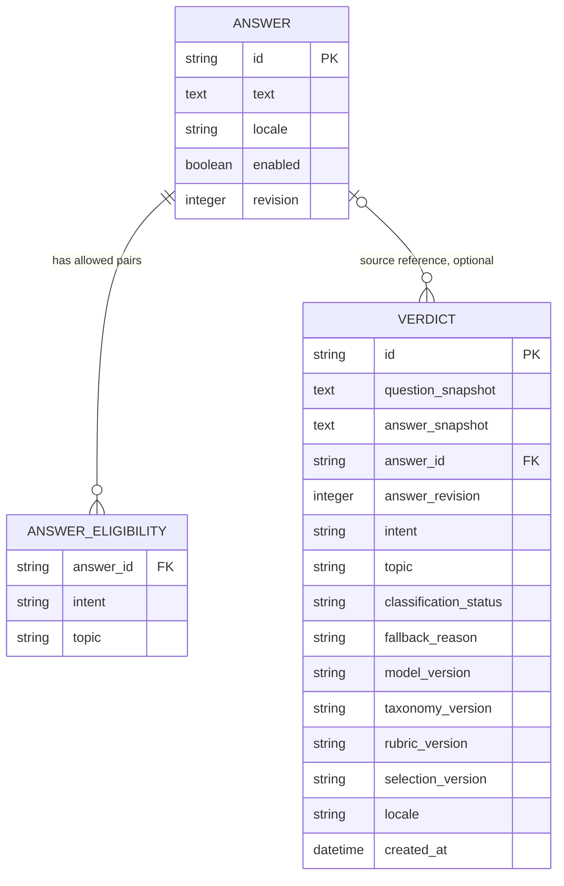

# Дані: пропозиція перед реалізацією

Поки БД не створена й Doctrine не встановлено. Користувач припускає SQLite локально й PostgreSQL (або іншу реляційну БД) у production. Плановий production target — PostgreSQL; остаточний вибір перед етапом міграцій.

## Модель

Імена полів/таблиць концептуальні, не згенерована schema. `ANSWER_ELIGIBILITY` має складений PK/unique `(answer_id, intent, topic)` та індекс `(intent, topic, answer_id)`. Перевірку enabled/locale виконує join до ANSWER. Для малого каталогу цього досить; інші індекси — за query plans.

## Чому зберігаємо пари

Окремі множини intent і topic створили б небажаний декартів добуток. Відповідь, дозволена для `(WHY, WORK)` та `(WHEN, TECH)`, не повинна автоматично ставати кандидатом для `(WHY, TECH)`. Кожен рядок eligibility — явна редакторська придатність. Категорії поки контрольовані string-backed enum з версією таксономії; окремий CRUD-довідник не потрібен до адмінки.

`ANY` означає універсальну форму відповіді; `OTHER` — класифіковане питання невідомої форми. Це різні поняття. `GENERAL` — загальна тема. Категорії не зберігати comma-separated полем; JSON не використовувати як основний індекс підбору.

Гумористичні теги не потрібні для MVP-запитів. Якщо дослідження підтвердить потребу — окремі mechanism tags і join table, без переписування класифікатора. Шаблони й ваги не додавати зараз.

## Незмінний вердикт

`VERDICT.id` — непередбачуваний UUIDv4 із unique constraint. Публічний URL не містить питання. Зберігати остаточний текст, а не тільки FK: редагування чи вимкнення ANSWER не змінює вже виданий permalink. `answer_id` може бути nullable reference; видалення джерела не повинно каскадно видаляти вердикти. Альтернатива — заборонити фізичне видалення каталогу і лише вимикати записи.

Для відтворюваності потрібні answer revision, фактична model version, taxonomy version, rubric version (текст instructions/criteria) і selection version. Це службові дані, не UI. Якщо класифікація не відбулась, model version може бути null, status явно позначає fallback. Не записувати «успішний Jev», коли його не було. При failure збережений контекст OTHER/GENERAL не означає вибір з OTHER-пулу: використовується безпосередньо ANY/GENERAL.

Транзакція починається після зовнішньої класифікації: читання придатної відповіді/її revision і insert snapshot узгоджуються в одному сценарії. Catalog import атомарний. Відповідь HTTP 201 — після commit. Failure на записі → 503, без непрацюючого URL.

Незмінність не дорівнює безстроковому зберіганню. Retention, видалення на запит і політика індексації потребують рішення перед public release. Видалений результат не має перевикористовувати ID.

## SQLite і PostgreSQL

Пропонується Doctrine DBAL + Migrations. [DBAL має платформи SQLite/PostgreSQL](https://www.doctrine-project.org/projects/doctrine-dbal/en/current/reference/platforms.html), але не робить їхні типи, блокування й DDL тотожними.

- UUID зберігати переносним рядком, час — UTC із узгодженою точністю; не покладатися на native enum/JSONB/array у базових запитах.
- Foreign keys у SQLite повинні бути ввімкнені на кожному connection. Випробувати це тестом, а не лише налаштуванням.
- SQLite файл у `var/`, за межами `public/`, без мережевої файлової системи. Busy timeout/WAL розглядати для dev після перевірки режиму тестів. SQLite не є доказом production-конкурентності.
- Міграції проганяти на порожній SQLite і на реальному PostgreSQL; SQL за потреби розгалужується за платформою. Не переносити автоматично SQLite-generated SQL на PostgreSQL.
- Для production прогнати query plans, Unicode/length constraints, unique/FK behavior, транзакційні помилки та конкурентні inserts.
- Локальна dev БД не мусить мігрувати у production як файл. Каталог переноситься контрольованим ідемпотентним import із стабільними IDs; вердикти за потреби — окремою перевіреною процедурою.

## Редакторський import

Початкова пропозиція — версійований файл контенту та console command import, без web admin. Формат визначається разом із каталогом, не нав'язується зараз. Перевіряти унікальні IDs, непорожній текст, locale `en`, дозволені intent/topic, відсутність дублікатів пар і щонайменше одну активну `(ANY, GENERAL)` відповідь. Помилка в одному записі не повинна залишати напівоновлений каталог.

Для MVP бажано покрити кожен підтримуваний intent щонайменше кількома різними GENERAL-відповідями. Кількість, редакторська якість і повторюваність — критерії контентного етапу, не обіцянка вже готової бібліотеки.
